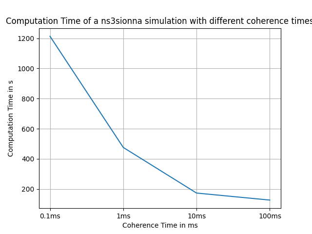
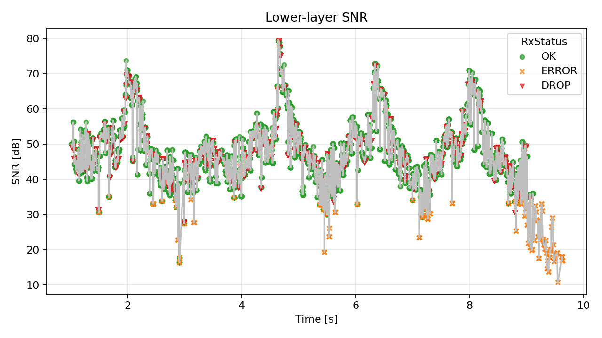
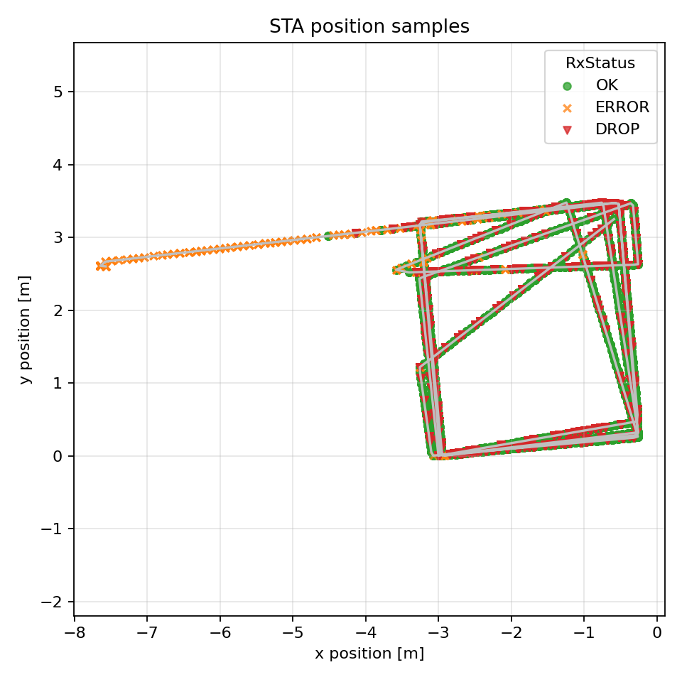
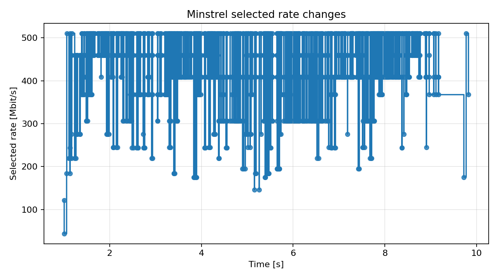
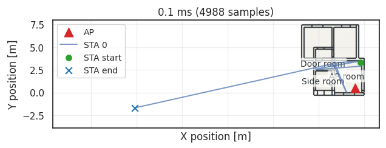
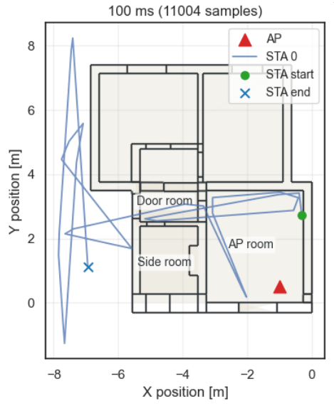

# Tutorial: Fixed Coherence Time and Mobility Control in ns3sionna

This guide walks through the mobility and channel-timing controls in ns3sionna.
It assumes ns3sionna is already installed and built as `contrib/sionna` inside
an ns-3 tree. See `README.md` for installation details.

In this guide, you will

- start the Python Sionna server with mobility options,
- run TCP examples with a fixed channel coherence time,
- use equidistant internal mobility steps,
- constrain random-walk mobility with the scene bounding box,
- run a small manual sweep,
- enable optional PHY, position, Minstrel, and wideband-loss logging.

## Table of Contents

- [Background Information](#background-information)
- [Starting the Sionna Server](#starting-the-sionna-server)
- [Running a Fixed-Coherence TCP Scenario](#running-a-fixed-coherence-tcp-scenario)
- [Absolute-Time Mobility](#absolute-time-mobility)
- [Bounding-Box Mobility Guard](#bounding-box-mobility-guard)
- [Small Manual Sweep](#small-manual-sweep)
- [Optional Logging and Debug Outputs](#optional-logging-and-debug-outputs)
- [Summary](#summary)

## Background Information

ns3sionna splits a simulation into two cooperating processes. The ns-3 side
creates WiFi nodes, traffic, mobility models, and channel requests. The Python
Sionna server loads the ray-tracing scene and answers those channel requests.

The main controls used in this guide are:

| Option | Where it is set | Meaning |
| --- | --- | --- |
| `--fixedCoherenceTimeMs` | ns-3 example | Controls channel-cache validity |
| `--equidistant_walk_steps` | Python server | Advances mobility in fixed internal time steps |
| `--mobility_bbox_toggle` | Python server | Enables or disables the outer mobility guard |
| `--mobility_bbox_margin` | Python server | Adds a margin around the scene bounding box |

The server-side options are chosen before a simulation run starts. The ns-3
options are passed to the example binary through `./ns3 run`.

## Starting the Sionna Server

Start with the default server if you do not need the additional mobility
controls:

```bash
cd ns-3.40/contrib/sionna/model/ns3sionna
./run.sh
```

For mobility experiments, use the equidistant-step wrapper:

```bash
cd ns-3.40/contrib/sionna/model/ns3sionna
./run_equidistant.sh
```

This starts `ns3sionna_server.py` with
`--equidistant_walk_steps 100000`. The value is in nanoseconds, so this means
that the server advances mobility in fixed 0.1 ms internal steps between ns-3
channel requests.

To also enable the bounding-box guard with a 1 m margin, use:

```bash
cd ns-3.40/contrib/sionna/model/ns3sionna
./run_equidistant_bbox.sh
```

This wrapper is equivalent to:

```bash
python ns3sionna_server.py \
  --equidistant_walk_steps 100000 \
  --mobility_bbox_toggle true \
  --mobility_bbox_margin 1.0
```

When the server is ready, it prints its configuration and waits for jobs from
ns-3. Keep this terminal open while running examples from a second terminal.

## Running a Fixed-Coherence TCP Scenario

Open a second terminal at the ns-3 root, the directory containing `./ns3`.
The short example scripts in `contrib/sionna/examples` show the minimal command
shape.

For PHY-level TCP sensing output:

```bash
cd ns-3.40/contrib/sionna/examples
./example-sionna-tcp-sensing-low.sh
```

The script runs:

```bash
cd ns-3.40
./ns3 run "ns3sionna-example-sionna-tcp-sensing-low \
  --fixedCoherenceTimeMs=100 \
  --dataRate=150 \
  --speed=1.0"
```

The example writes a CSV file named
`example-sionna-tcp-sensing-low-l1.csv`. Each row corresponds to a PHY data
frame reception at the STA and contains time, node ID, position, pathloss, RX
power, SNR, reception status, packet UID, packet size, and failure reason.







For TCP with MinstrelHt rate adaptation:

```bash
cd ns-3.40/contrib/sionna/examples
./example-sionna-tcp-minstrel.sh
```

This writes:

- `example-sionna-tcp-minstrel-tx-vectors.csv` for per-transmission WiFi mode
  and rate samples.
- `example-sionna-tcp-minstrel-rate-changes.csv` for Minstrel rate-change
  events.



## Absolute-Time Mobility

By default, mobility is updated when ns-3 asks the Python server for a channel.
This request-based mode is simple, but the effective mobility integration step
depends on the traffic pattern and the channel request schedule. This ensures the mobility
of a station is the same across multiple coherence times. Recorded values may still differ
based on how the mobility is recorded.

`--equidistant_walk_steps` switches the server to fixed internal mobility steps.
For example:

```bash
python ns3sionna_server.py --equidistant_walk_steps 100000
```

With this setting, the server advances random-walk mobility in 100000 ns
increments until it reaches the requested ns-3 simulation time. Set the value to
`0` to use the request-based behavior:

```bash
python ns3sionna_server.py --equidistant_walk_steps 0
```

The wrapper script `run_equidistant.sh` uses the same `100000` ns step as
`examples/watchdog.sh`.

## Bounding-Box Mobility Guard

The bounding-box guard prevents random-walk nodes from drifting indefinitely
outside the Sionna scene. It uses the scene bounding box in x/y, expands it by
`--mobility_bbox_margin`, and reflects movement at that outer limit.

Scene walls are still handled by the normal ray-intersection logic. The
bounding-box guard is an outer safety guard, not a replacement for scene
geometry. It does not reflect any other rays and only affects mobility.

Enable it explicitly with a 1 m margin:

```bash
python ns3sionna_server.py \
  --mobility_bbox_toggle true \
  --mobility_bbox_margin 1.0
```

It is disabled by default. Not every environment requires a bounding box, this is
intended for small environments with high mobility.

The wrapper script `run_equidistant_bbox.sh` combines the 100000 ns mobility
step with `--mobility_bbox_toggle true` and `--mobility_bbox_margin 1.0`.





Other useful runtime controls are:

- `--rt_max_num_paths_per_src`: limit the number of stored Sionna RT paths per
  source.
- `--rt_fast`: use a faster, less detailed ray-tracing configuration.

## Summary

You have seen how to start the ns3sionna server, run fixed-coherence TCP
examples, advance mobility with equidistant internal time steps, constrain
random-walk mobility with the scene bounding box, and collect optional debugging
and measurement outputs.

For short experiments, the example scripts show the intended command shape. For
longer measurement campaigns, `examples/watchdog.sh` provides the restart,
retry, timeout, and output-management logic around the same server and ns-3
controls.
